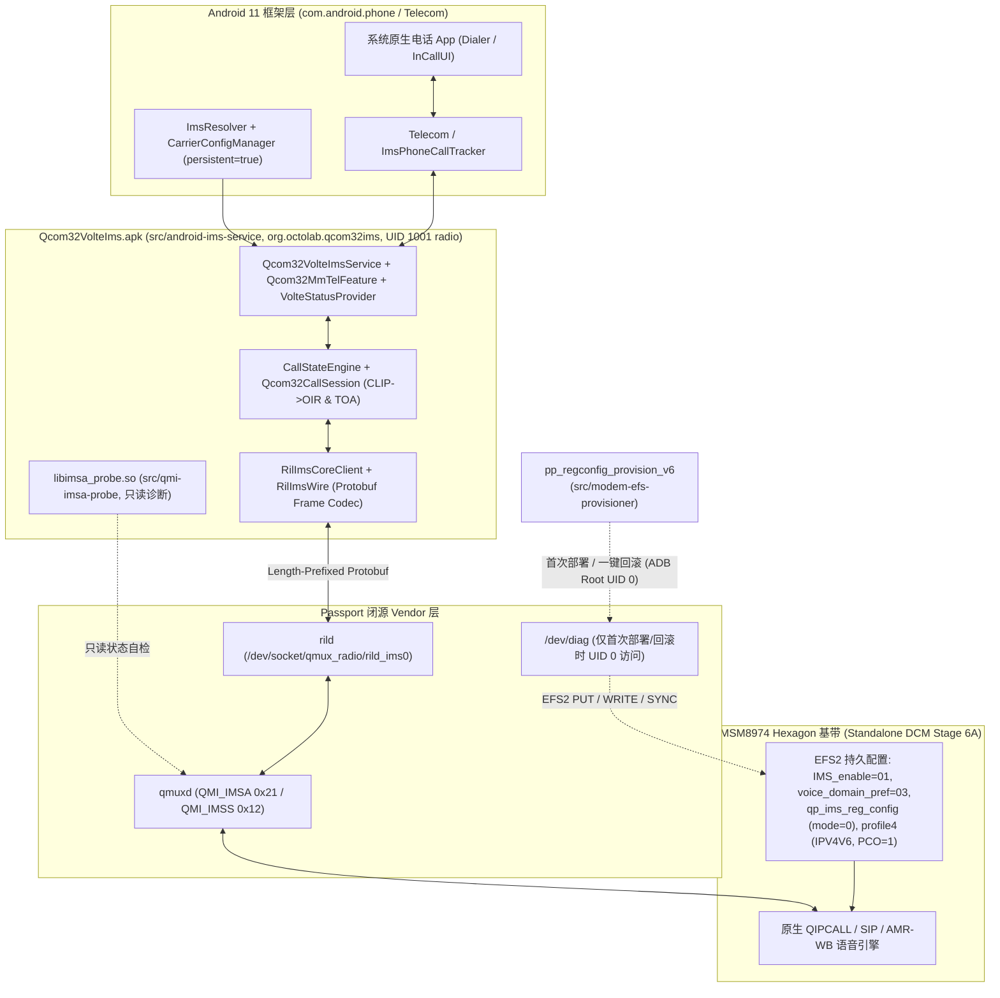

# 系统架构与工作原理 (`ARCHITECTURE.md`)

本文档说明 BlackBerry Passport (`wolverine` / Qualcomm Snapdragon 801 `MSM8974` / LineageOS 18.1 Android 11) 原生 VoLTE 方案的端到端技术架构。

---

## 1. 为什么原版 LineageOS 18.1 + Passport 无法使用 VoLTE？

BlackBerry Passport 出厂运行 BlackBerry 10 (QNX) 系统，刷入社区移植的 LineageOS 18.1 (Android 11) 后，存在**上下两层同时断裂**的问题：

1. **基带层（Hexagon Modem EFS 缺失）**：
   - 出厂基带固件 (`.DI.4.0.1-00158-M8974AAAAANAZM-1`) 内含完整的 IMS/QIPCALL 协议栈，但默认 `IMS_enable = 00`、`voice_domain_pref = 00` (仅电路域 CS 语音)；
   - 基带 EFS 中缺失 `qp_ims_reg_config`、`ims_operation_mode`、`qp_ims_sms_config`、`qipcall_*` 等 50 个必需配置项；
   - 基带内置第 4 号承载配置 `/pdp_profiles/profile4` (`ims`) 的禁用标志位 `apn_disabled_flag (byte[753])` 被置为 `1`，且未开启 `im_cn_flag` 与 `request_pcscf_address_flag`。
2. **Android 框架层（缺少现代 Android 11 `ImsService` 桥接器）**：
   - Passport 厂商闭源 `rild` 通过 Unix Domain Socket `/dev/socket/qmux_radio/rild_ims0` 暴露的是高通早期 **Protobuf-over-Socket** 私有接口（非现代 HIDL `IImsRadio`）；
   - Android 11 框架 (`ImsResolver` / `ImsManager` / `ImsPhoneCallTracker`) 需要标准的 `android.telephony.ims.ImsService` + `MmTelFeature` + `ImsCallSessionImplBase`，原系统中对应服务发现与绑定全部为空。

---

## 2. 端到端分层架构图

本方案**不修改内核、不刷改基带分区、不关闭 SELinux (`Enforcing`)、不在应用层重造 SIP/RTP 协议栈**，而是直接打通高通硬件基带原生 IMS 引擎与 Android 11 原生电话框架：

---

## 3. 三大生产组件详解

### 3.1 `src/modem-efs-provisioner` (`pp_regconfig_provision_v6`)
- **运行阶段**：仅在**首次激活部署**或**一键回滚恢复出厂**时通过 `adb root` (`UID 0`) 运行一次，平时手机运行完全不需要它驻留。
- **核心职责**：
  1. 通过 `/dev/diag` HDLC 帧与基带 EFS2 子系统 (`0x4B 0x13`) 通信，内置 CRC-16 校验与 SHA-256 写后读回核验；
  2. 写入 **Stage 6A 独立基带 DCM 配置**：
     - `qp_ims_reg_config` 采用 **`mode=0`（3GPP 标准动态发现模式）**：不含任何写死的运营商 IP，由基带自动从当前插入的 USIM 卡推导归属 IMS 域名并向 LTE 基站请求 PCO P-CSCF 地址；
     - 修正 `/pdp_profiles/profile4`（789 字节）：启用 `IPV4V6` 双栈、设置 `APN="ims"`、`im_cn_flag=1`、`request_pcscf_address_flag=1`、`apn_disabled_flag=0`；
     - 设置 `ims_operation_mode=02`、`voice_domain_pref=03` (`IMS_PS_VOICE_PREFERRED_CS_SECONDARY`，即优先 VoLTE、无 VoLTE 时自动回退 CSFB)、`IMS_enable=01`，并执行 `EFS2_DIAG_SYNC` 落盘；
  3. 支持 `--rollback-all`：先回写 `IMS_enable=00` 与 `voice_domain_pref=00`，再逐一 `UNLINK` 删除全部新建条目并 `SYNC`，100% 还原出厂基带基线。

### 3.2 `src/android-ims-service` (`Qcom32VolteIms.apk` v2.6)
- **运行身份**：包名 `org.octolab.qcom32ims`，声明 `android:sharedUserId="android.uid.phone"`，使用 LineageOS 平台签名安装于 `/data/app/`（或集成至 `/system_ext/priv-app/`），运行在独立 `:qcom32ims` 进程（`UID 1001` / SELinux `u:r:radio:s0`），**零 `<uses-permission>` 声明**（不触碰 `com.android.phone` 原有系统电话权限），全程严守 `SELinux Enforcing`。
- **开机自启、三网换卡自愈与跨重启持久化**：
  - `CarrierConfigBootstrapReceiver` 入口内置 7 项系统 `<protected-broadcast>` 白名单校验（阻断非特权显式 Intent 伪造），监听 `LOCKED_BOOT_COMPLETED`、`BOOT_COMPLETED`、`SIM_STATE_CHANGED` 与 `ACTION_CARRIER_CONFIG_CHANGED`；
  - 对当前活跃 SIM `subId` 调用 `@SystemApi` 三参版 `CarrierConfigManager.overrideConfig(subId, bundle, /*persistent=*/true)` 开启 VoLTE 能力并指定 `config_ims_mmtel_package_override_string = "org.octolab.qcom32ims"`，使 `ImsResolver` 在开机或更换新 SIM 卡后无需电脑干预自动拉起并绑定 `Qcom32VolteImsService`。
- **免 `su` 只读状态导出 (`VolteStatusProvider`)**：
  - 导出零权限要求的只读 `content://org.octolab.qcom32ims.status` (`call("get_status")`)，带 2.5 秒 QMI 探针限流缓存与严格零 PII 脱敏（仅返回数值 MCC/MNC PLMN、RAT 枚举与布尔/整型注册位），供手机端 `Qcom32VolteManager.apk` 在拔掉数据线且未装 Magisk 时直接展示底层实时状态。
- **通话控制与来电显示修复**：
  - `RilImsCoreClient` 维持与 `/dev/socket/qmux_radio/rild_ims0` 的长连接，实时把基带 `REGISTRATION_STATE`、`SRV_STATUS_LIST`、`CALL_STATE_CHANGED`、`RING` 映射为 Android 11 `ImsRegistrationImplBase` 与 `Qcom32MmTelFeature` 事件；
  - `Qcom32CallSession` 实现主被叫拨号 (`DIAL`)、振铃接听 (`ANSWER`)、拒接/挂断 (`HANGUP`)、保持/恢复 (`SWITCH_WAITING_OR_HOLDING_AND_ACTIVE`)、DTMF，以及 3GPP `CLIP` -> Android `OIR` 号码显示转换与 `TOA=145` 国际冠字 `+` 补齐；
  - 硬件语音通道由高通基带 `QIPCALL` + DSP (`AMR-WB`, `vsid=0x10c02000`) 原生承载，系统 `InCallUI` 听筒/免提/麦克风控制全部走原生音频路由。

### 3.3 `src/qmi-imsa-probe` (`libimsa_probe.so`)
- 随独立 APK 打包于 `lib/armeabi-v7a/libimsa_probe.so`（ROM 源码集成模式下安装于 `/system_ext/bin/libimsa_probe.so`，由 `Qcom32VolteImsService` 自动解析路径）的轻量 ARM32 只读诊断探针。
- 当管理员执行 `dumpsys activity service org.octolab.qcom32ims/.Qcom32VolteImsService --qmi-probe`（或由 `VolteStatusProvider` 调用）时，通过 `libqmi_client_qmux.so` 只读读取 `QMI_IMSA` 的实时 `pdp_connected`、`reg_status`、`voip` 与 `voip_rat` 状态，用于秒级故障定位。
